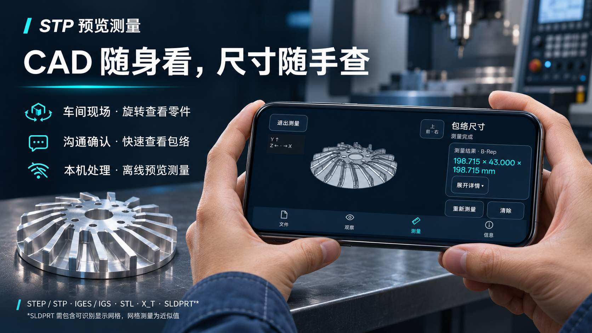

# STP 预览测量

*使用场景示意图，基于实际测量界面制作。*

免费的 Android 离线 CAD 预览与测量工具，模型在手机本地处理。

[直接下载 0.1.7 旧版覆盖安装 APK](https://github.com/LOR1TA/stp-preview-downloads/releases/download/v0.1.7/STP-Preview-0.1.7-legacy-upgrade.apk)

[版本说明](https://github.com/LOR1TA/stp-preview-downloads/releases/tag/v0.1.7)

支持 STEP/STP、IGES/IGS、STL、X_T，以及含可识别已保存显示网格的 SLDPRT。STEP/IGES 支持 B-Rep 测量，SLDPRT 显示网格的测量结果标明网格近似。SLDPRT 未知原始单位默认按米换算为毫米，可手动指定单位。

## 安装

适用 Android 10 及以上的 ARM64 手机。进入版本页面，在 Assets 中下载 `.apk` 后安装。

0.1.7 提供旧版覆盖安装包，使用此前测试版的签名，供已安装旧签名版本的用户直接升级。出现签名冲突时，请先保留现有应用并核对所下载安装包的签名。

## 0.1.7 更新

- 修复部分 SLDPRT 显示网格被缓存索引跳过的问题。
- 优化复杂 STEP 的 B-Rep 包络计算，复杂模型计算仍可能需要等待。
- 文件标题、信息与测量结果统一显示当前测量单位。

## 文件校验与验证状态

文件名为 `STP-Preview-0.1.7-legacy-upgrade.apk`，大小 82,628,310 字节。

SHA-256 为 `AE0C707BCB0FB8B22D78BECCDE0D7F0EB09246B3F641378B6A071DA4C30F25F3`。

0.1.7 已通过 105 项 JVM 单元测试、原生测试、构建及 lint、Android 模拟器回归和覆盖升级。实体手机尚待复测。
